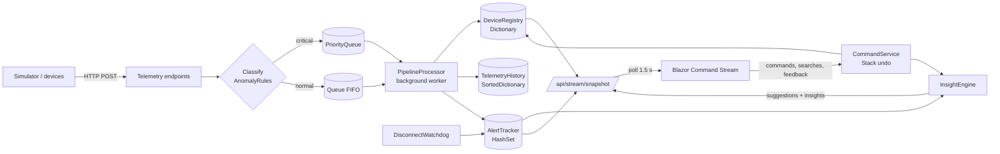

# Smart-X IoT Mesh Gateway

**PROG7312 – Portfolio of Evidence, Part 2: Real-Time Processing and Device Management**

Smart-X is a simulated IoT gateway. Devices (ESP32-style sensors, smart plugs, pumps, valves) send telemetry over HTTP; the gateway ingests it, classifies it, stores it, raises alerts, lets an operator control actuators, and learns from what the operator does.

| Pillar | Status |
|---|---|
| 1. Sensor Data Ingestion & Telemetry (Part 1) | Working, still available from menu |
| 2. Real-Time Command Stream & History (Part 2) |  **This submission** |
| 3. Network Topology & Mesh Routing (Part 3) | Greyed out until the final PoE |

---

## Contents

1. [Tech stack](#tech-stack)
2. [Prerequisites](#prerequisites)
3. [Run it](#run-it)
4. [Using the application](#using-the-application)
5. [How to test each Part 2 requirement](#how-to-test-each-part-2-requirement)
6. [Architecture and data structures](#architecture-and-data-structures)
7. [API reference](#api-reference)
8. [Configuration](#configuration)
9. [Part 1 improvements](#part-1-improvements)
10. [Project structure](#project-structure)
11. [Troubleshooting](#troubleshooting)

---

## Tech stack

- **Backend:** ASP.NET Core Minimal API (.NET 10)
- **Frontend:** Blazor WebAssembly (.NET 10)
- **Shared library:** models, generics, operator overloading, recursion (`SmartX.Shared`)
- **Device simulator:** .NET console app that POSTs to the API like a real fleet (`SmartX.Simulator`)
- **Containers:** Docker + Docker Compose (nginx serves the client)

No database is used. All gateway state is held in memory by purpose-built collections (see [Architecture](#architecture-and-data-structures)), so every run starts from the same seeded demo data.

## Prerequisites

| Tool | Version | Needed for |
|---|---|---|
| [.NET SDK](https://dotnet.microsoft.com/download) | 10.0 or later | running locally |
| [Docker Desktop](https://www.docker.com/products/docker-desktop/) | any recent | running with containers (optional) |
| A modern browser | Edge / Chrome / Firefox | the client |

Check your SDK: `dotnet --version`

## Run it

### Option A – locally with the .NET CLI

```bash
git clone https://github.com/st10440432/prog7312POEPart2.git
cd prog7312POEPart2
dotnet restore SmartX.slnx
dotnet build SmartX.slnx
```

Trust the development HTTPS certificate once (the client talks to the API over HTTPS by default):

```bash
dotnet dev-certs https --trust
```

Open **two terminals** in the repo folder.

**Terminal 1 – API** (listens on `https://localhost:7086` and `http://localhost:5248`):

```bash
dotnet run --project SmartX.Api --launch-profile https
```

**Terminal 2 – Client** (opens on `https://localhost:7011`):

```bash
dotnet run --project SmartX.Client --launch-profile https
```

Browse to **https://localhost:7011**.

> If you cannot trust the certificate, run the API with `--launch-profile http` and change `ApiBaseUrl` in `SmartX.Client/wwwroot/appsettings.json` to `http://localhost:5248/`.

**Terminal 3 (optional) – device simulator:**

```bash
dotnet run --project SmartX.Simulator -- demo
```

It registers ~21 devices and sends telemetry every second. See [simulator scenarios](#simulator-scenarios).

### Option B – Docker Compose

```bash
docker compose up --build
```

| Service | URL |
|---|---|
| Client | http://localhost:8081 |
| API | http://localhost:8080 |

Add the simulated device fleet:

```bash
docker compose --profile sim up --build
# or choose a scenario:
SIM_SCENARIO=demo docker compose --profile sim up --build
```

Stop everything with `docker compose down` (add `-v` to also delete uploaded files).

## Using the application

1. **Home** shows the three pillars. Pillars 1 and 2 are active; pillar 3 is disabled.
2. **Sensor Ingestion (Part 1)** – register sensors, submit readings, attach files, view live tables with anomaly highlighting and the deployment hierarchy. Its tables now refresh automatically every 3 seconds.
3. **Command Stream (Part 2)** – the live operations console:
   - **Status strip** – FIFO / priority queue depth, average latency per lane, active alerts, duplicate alerts blocked, undo-stack depth.
   - **Devices** – search (name, MAC, location, category), category chips, "problems only" toggle. Actuators have **Turn ON / Turn OFF**.
   - **Telemetry Timeline** – time-ordered chart for any device (dashed lines = safe range).
   - **Suggested Actions** – one-click actions predicted from your past behaviour, with confidence.
   - **Automated Insights** – devices heading for trouble (trends, flapping relays) before they alarm.
   - **Manual Overrides** – bulk "shut down all …" and **Undo last command**, plus command history.
   - **Active Alerts**, **Pipeline Log** and **Simulation Tools**.

Filters, the selected timeline device, form drafts and the last data snapshot are kept in an app-wide state service, so switching between pillars and back does not lose your place.

If the API stops, the pages show a "Gateway unreachable" banner and retry automatically instead of crashing.

### Seeded demo data

On every start the API registers 9 devices (moisture sensors, smart meters, pumps, valves, a relay) and loads readings that **deliberately contain anomalies**: two out-of-range moisture readings and a power spike. It also seeds a few hours of *pretend operator behaviour* so the suggestion engine has something to say immediately. That behaviour is demo data; the engine keeps learning from your real searches and commands on top of it.

Devices that stop reporting are flagged **Disconnected** after 60 seconds, so with no simulator running the seeded devices will go grey after a minute. Start the simulator to keep them live.

### Simulator scenarios

```bash
dotnet run --project SmartX.Simulator -- <scenario> [--api URL] [--interval ms] [--extra N] [--count N]
```

| Scenario | What it does |
|---|---|
| `normal` (default) | Continuous healthy telemetry for the whole fleet. Actuators report whatever state the gateway commanded. |
| `demo` | `normal` plus a random anomaly roughly every 20 s. |
| `power-spike` | One +1,400 W spike on Smart Meter 3, then exits. |
| `moisture-drop` | Moisture Sensor 1 reports a severe low reading, then exits. |
| `disconnect` | `normal`, but Smart Meter 4 and Pump B go silent. |
| `flood` | Sends `--count` (default 300) normal packets, then a critical spike while the backlog drains, and prints both latencies. |

The simulator defaults to `http://localhost:5248`. In Docker it uses `http://smartx-api:8080`.

## How to test each Part 2 requirement

> Start the API and client first. Steps to use the UI as well as steps to use the terminal are below.

### Queues – FIFO + priority lane

**Command Stream → Simulation Tools → "Flood 300 packets + spike".** A batch of 300 normal readings fills the FIFO lane, then a critical power spike arrives. The message reports that the spike took the **Priority** lane and finished in a few milliseconds; the Pipeline Log shows the priority row among FIFO rows, and the *Avg latency* tile shows priority vs FIFO.

Same thing with the simulator:

```bash
dotnet run --project SmartX.Simulator -- flood --count 300
```

Expected output (numbers vary):

```
Critical packet : lane=Priority, latency=4 ms
Normal packets  : lane=FIFO, avg latency=700 ms, max=1500 ms
```

### Stack – undo

1. On a pump (e.g. **Pump A**), click **Turn ON**. It appears in Command History.
2. Click **Shut down all** with the filter `valve`. Both valves turn off as one command.
3. Click **Undo last command** – both valves are restored together. Click it again – Pump A turns back off. The counter on the button is the stack depth; at 0 it is disabled.

### Dictionary – instant device lookup

Every telemetry packet is matched to its device by MAC / id in O(1) through a `Dictionary`. Search for a MAC fragment in the **Devices** box, in terminal:

```bash
curl http://localhost:5248/api/sensors/AA:BB:CC:00:00:06
```

### SortedDictionary – timelines

Pick any device under **Telemetry Timeline**; the points are already ordered by time. ⌨:

```bash
curl "http://localhost:5248/api/telemetry/AA:BB:CC:00:00:02/history?minutes=30&max=100"
```

### HashSet – duplicate alert suppression

**Simulation Tools → "Repeat one alert ×5".** The same out-of-range reading is sent five times; the alert is raised once and the **Duplicates blocked** tile goes up.

Disconnects: stop the simulator and wait 60 s. Each device gets exactly one *Disconnected* alert even though the watchdog re-detects it every 5 s – the *Duplicates blocked* counter climbs. Restart the simulator and the alerts clear.

### Predictive / suggestion engine

1. Open **Command Stream**. Because of the seeded history, **Suggested Actions** already lists e.g. *Turn ON Pump A – after an alert on Moisture Sensor 1, this followed 6 of 6 times (100%)*.
2. Click **Simulation Tools → "Low moisture on Sensor 1"**. A fresh alert fires and the suggestion is shown against the live alert.
3. Click **Do it**. The pump turns on, the suggestion disappears (already satisfied) and its weight increases.
4. Click **Dismiss** on another suggestion – it is hidden for 90 s and its weight drops, so it ranks lower next time.
5. Search for a device and press Enter, or click **Timeline** on devices. These actions are logged and become new patterns the engine can suggest from.
6. **Automated Insights** also shows devices trending toward a limit (for example a moisture probe falling ~1 point per reading) or relays that toggle repeatedly.

### Navigation and state

Type a search and pick a category on **Command Stream**, go to **Sensor Ingestion**, start typing a new sensor, then come back. Filters and the form draft are still there, and the page renders instantly from the last snapshot.

Stop the API while a page is open: a banner appears and data resumes when the API is back.

## Architecture and data structures



| Requirement | Structure | Where | Why |
|---|---|---|---|
| Standard stream | `Queue<IngestItem>` | `IngestionPipeline` | Normal telemetry is processed strictly in arrival order. |
| Critical alerts | `PriorityQueue<IngestItem, (int, long)>` | `IngestionPipeline` | Priority then sequence number (stable). The worker always drains it first, so critical packets bypass the FIFO backlog. |
| Undo history | `Stack<ExecutedCommand>` | `CommandService` | Each entry remembers the previous state of every device it touched; Undo pops the newest. |
| Instant lookup | `Dictionary<string, DeviceEntry>` | `DeviceRegistry` | O(1) lookup by MAC/id for every packet, command and search. Case-insensitive keys. |
| Sorted timelines | `SortedDictionary<HistoryKey, HistoryPoint>` per device | `TelemetryHistory` | Ordered by `(timestamp, sequence)`; the sequence stops two equal timestamps colliding. Capped per device. |
| Unique alerts | `HashSet<string>` of `deviceId:type` | `AlertTracker` | `Add` returning `false` is the duplicate check, in O(1). |
| Learning window | `Queue<WindowEvent>` | `InsightEngine` | Sliding 5-minute window of recent events. |
| Learned patterns | `Dictionary<string, Dictionary<string,int>>` | `InsightEngine` | `transitions[A][B]` = times B followed A. |
| Ranking | `PriorityQueue<SuggestedAction, double>` | `InsightEngine` | Best suggestion first. |

### How the predictive engine works

Every alert, search and command becomes a token (`Alert:<id>`, `Search:<id>`, `Cmd:<id>:On`, `Disconnect:<id>`). For each new event, every earlier event still inside the 5-minute window gets a "followed by" count. So after "alert on Moisture Sensor 1 → search Pump A → turn Pump A on" happens a few times, the engine knows:

```
confidence(Alert:Sensor1 → Cmd:PumpA:On) = followed / times the alert has played out
```

When a live alert (or something you just did) has learned follow-ups with **at least 2 occurrences and ≥ 40% confidence**, they become candidates. Score = `confidence × (1 + ln(support)) × feedback weight × (1.5 if triggered by a live alert)`. Suggestions already satisfied (pump already ON), recently dismissed, or already acted on are filtered out. Accepting multiplies a suggestion's weight by 1.25 (max 2); dismissing multiplies by 0.6 and hides it for 90 s.

Separately, **Automated Insights** compute a least-squares slope over each device's recent readings to warn before a limit is crossed, and count state flips on actuators to spot relay chatter.

### Real-time updates

The Command Stream page polls a single aggregated endpoint (`/api/stream/snapshot`) every 1.5 s with a `PeriodicTimer`, which is robust behind Docker/nginx and needs no extra packages. The poll loop is cancelled when you leave the page.

### Concurrency

Singletons are shared by every request, the background worker and the watchdog, so each collection is guarded by its own lock. Locks are never nested in opposite orders (registry → history/alerts, never the reverse).

## API reference

Base URL: `http://localhost:5248` (local) or `http://localhost:8080` (Docker). A ready-to-run set of requests is in [`SmartX.Api/SmartX.Api.http`](SmartX.Api/SmartX.Api.http).

| Method | Route | Description |
|---|---|---|
| GET | `/api/sensors` | All registered sensors |
| GET | `/api/sensors/{id}` | One sensor (dictionary lookup) |
| POST | `/api/sensors` | Register a sensor (location validated recursively; 409 if duplicate) |
| POST / GET | `/api/sensors/{id}/files` | Upload / list attached files (max 10 MB) |
| GET | `/api/zones` | Deployment hierarchy with recursive sensor/alert roll-ups |
| GET | `/api/telemetry` | Newest readings per category (Part 1 dashboard) |
| GET | `/api/telemetry/{id}/history?minutes=&max=` | Time-ordered readings for one device |
| POST | `/api/telemetry/environmental` | `{deviceId, value: float}` |
| POST | `/api/telemetry/power` | `{deviceId, value: int}` (watts, ≥ 0) |
| POST | `/api/telemetry/actuator` | `{deviceId, value: bool}` |
| POST | `/api/telemetry/batch` | `{readings:[{deviceId,value}]}` – up to 2000, returns 202 |
| GET | `/api/stream/snapshot?search=&category=&alertsOnly=` | Everything the dashboard needs in one call |
| POST | `/api/commands` | `{deviceId, action}` – action: 0 on, 1 off, 2 toggle |
| POST | `/api/commands/bulk` | `{filter, action}` – e.g. every actuator matching "valve" |
| POST | `/api/commands/undo` | Pop the stack and restore previous state |
| GET | `/api/commands/history` | Executed commands and undos, newest first |
| GET | `/api/commands/desired-state` | What each actuator should be doing (devices poll this) |
| GET | `/api/insights` | Suggested actions and automated insights |
| POST | `/api/insights/events` | `{term}` – report a search so the engine can learn |
| POST | `/api/insights/feedback` | `{suggestionId, accepted}` |

Telemetry POSTs return **201** with `{lane, latencyMs, reason}` once processed, or **202** if the queue is too backed up to wait (3 s). They return **404** for an unknown device and **400** for a category mismatch or invalid value.

## Configuration

API settings live in the `Gateway` section of `SmartX.Api/appsettings.json` and can be overridden with environment variables (`Gateway__StaleAfterSeconds=15`).

| Setting | Default | Meaning |
|---|---|---|
| `ProcessingDelayMs` | 5 | Simulated per-packet processing cost. Makes queue backlogs (and the priority bypass) visible. Set `0` for full speed. |
| `StaleAfterSeconds` | 60 | A silent device is flagged Stale, then Disconnected. |
| `WatchdogIntervalSeconds` | 5 | How often the disconnect scan runs. |
| `MaxHistoryPerDevice` | 500 | Timeline readings kept per device. |

Anomaly thresholds are in `SmartX.Shared/Models/AnomalyRules.cs` (environmental safe range 15–85, severe below 10 / above 90, power spike > 500 W jump).

Client API address: `SmartX.Client/wwwroot/appsettings.json` (`ApiBaseUrl`); Docker uses `appsettings.Docker.json`.

## Part 1 improvements

Feedback from the Part 1 marking has been addressed.

**Operator overloading on `TelemetryPacket<T>`.** The overloads previously lived on a separate `PowerMeterReading` class that was only used in one UI method. They are now on the generic packet itself:

- `TelemetryPacket<T>` (`T : struct, IComparable<T>`) overloads `>`, `<`, `>=`, `<=`, which work for float, int and bool without boxing.
- `NumericTelemetryPacket<T>` (`T : struct, INumber<T>`) adds `+` (aggregate load of two devices) and `-` (signed delta between two readings) using .NET generic math.
- These are used for real: the API classifies power spikes with `current - previous`, the alert logic and client highlighting use `AnomalyRules.IsPowerSpike`, and `PowerMeterReading` has been removed.

**Recursive validation.** `DeploymentZone.Validate` existed but was never called. Now:

- A sensor's `DeploymentLocation` is parsed into a zone tree (`DeploymentZone.Parse`) and validated recursively in `POST /api/sensors`; a bad path (empty segment, name too long, deeper than 8 levels) returns 400 naming the offending path.
- `ZoneTreeBuilder` builds and rolls up the whole hierarchy recursively for `GET /api/zones`.
- The client renders it with a recursive Blazor component (`ZoneNode.razor`) in **Sensor Ingestion → Deployment Hierarchy**.

Also fixed: historical readings were stamped with identical timestamps; they are now spaced out, which the sorted timelines require.

## Project structure

```
SmartX.slnx
docker-compose.yml
SmartX.Shared/                 Models shared by API, client and simulator
  Models/
    TelemetryPacket.cs         Generic packet + operator overloads
    AnomalyRules.cs            Single source of truth for thresholds
    DeploymentZone.cs          Recursive zone tree + validation
    ZoneTree.cs                Recursive roll-up for the hierarchy view
    StreamModels.cs            Part 2 DTOs
SmartX.Api/
  Endpoints/                   Sensor, Telemetry, FileUpload, Stream, Command, Insight
  Services/
    DeviceRegistry.cs          Dictionary
    IngestionPipeline.cs       Queue + PriorityQueue, worker, watchdog
    TelemetryHistory.cs        SortedDictionary
    AlertTracker.cs            HashSet
    CommandService.cs          Stack (undo)
    InsightEngine.cs           Predictive engine
    DataSeeder.cs              Demo devices, readings and operator history
SmartX.Client/
  Pages/                       Home, Sensors (Part 1), CommandStream (Part 2)
  Components/                  TimelineChart (SVG), ZoneNode (recursive)
  Services/                    ApiClient, AppState
  Layout/                      NavMenu, MainLayout (error boundary)
SmartX.Simulator/              Device fleet + scenarios
docs/DEMO_SCRIPT.md            Walk-through for the demo video
```

## Troubleshooting

| Problem | Fix |
|---|---|
| Client shows "Gateway unreachable" | Start the API. Check `ApiBaseUrl` matches how you started it (HTTPS profile ↔ `https://localhost:7086/`). |
| Browser blocks API calls / certificate warning | Run `dotnet dev-certs https --trust`, restart the browser. Or use the `http` profile and `http://localhost:5248/`. |
| Everything turns "Disconnected" after a minute | Nothing is sending telemetry. Start the simulator, or raise `Gateway__StaleAfterSeconds`. |
| Port already in use | Stop the other process or change `applicationUrl` in the project's `launchSettings.json` (and `ApiBaseUrl`). |
| Docker build cannot restore | Check network access to nuget.org; rerun `docker compose build --no-cache`. |
| Uploads vanish in Docker | They persist in the `smartx-uploads` volume; `docker compose down -v` deletes it. |
